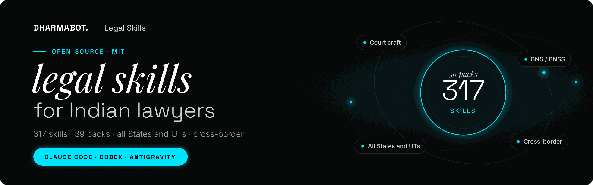
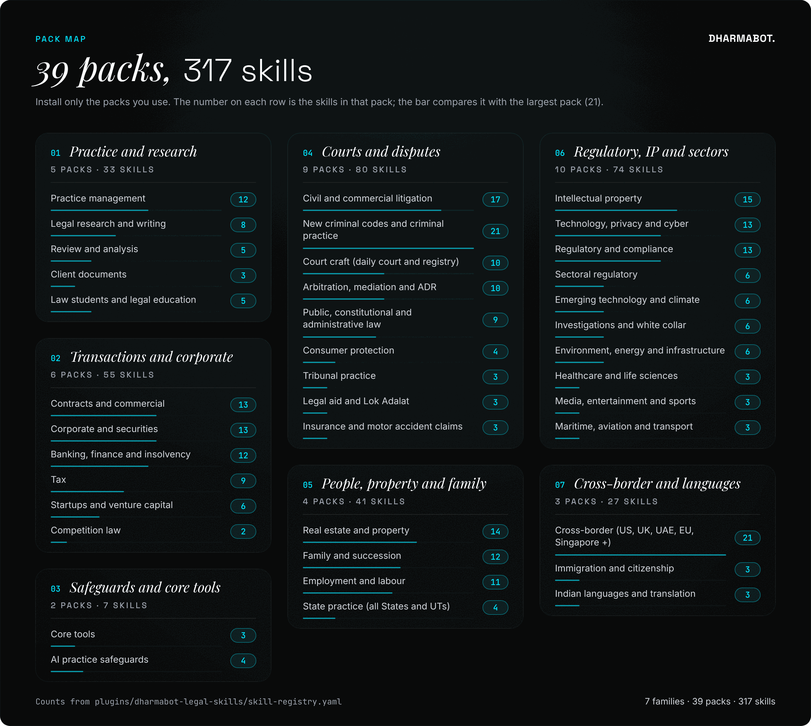
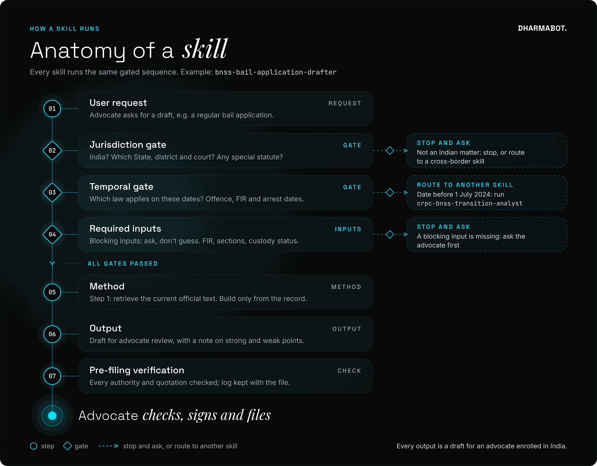
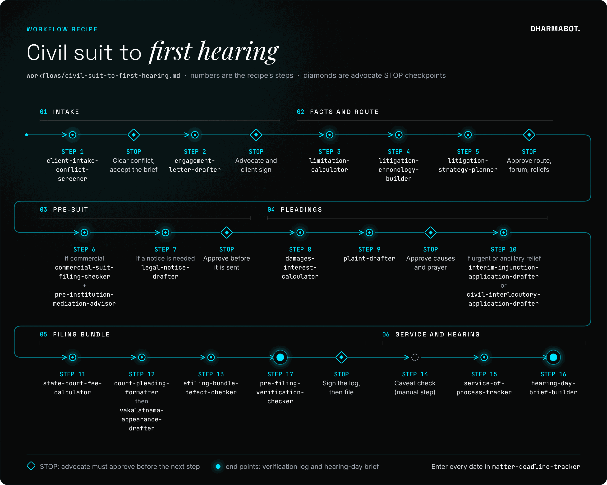
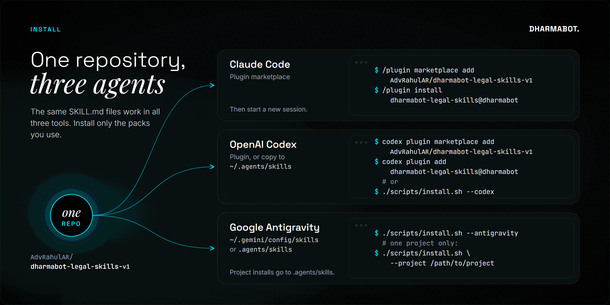

<p align="center">
  
</p>

# Dharmabot Legal Skills

Free, open-source AI skills for Indian lawyers, by [Dharmabot AI](https://dharmabot.ai). They work in **Claude Code**, **OpenAI Codex** and **Google Antigravity**.

The collection covers the work of an Indian law practice end to end:

- **Practice areas:** litigation and daily court craft, tribunals, criminal practice under the BNS, BNSS and BSA, arbitration, contracts, corporate, startups, banking and insolvency, tax, property, family, employment, IP, technology and privacy, regulatory and sector work, public law and investigations.
- **Who it serves:** practice management, legal aid and law students.
- **Where it applies:** all 36 States and Union Territories, Indian languages, and cross-border work for clients and firms in the US, UK, UAE, EU, Singapore and elsewhere.

> **Status: v0.1.0 alpha.** Every skill was reviewed for legal accuracy after drafting, but none has yet been signed off by an enrolled advocate. Every output is a draft for an advocate to check. Read the [disclaimer](DISCLAIMER.md).

## What's inside

<!-- CATALOGUE:START -->

**317 skills in 39 packs.** The full list with one line per skill is in [docs/CATALOGUE.md](docs/CATALOGUE.md).

| Pack | Skills | Install with |
| --- | --- | --- |
| [Practice management](docs/CATALOGUE.md#practice-management) | 12 | `--pack practice-management` |
| [Legal research and writing](docs/CATALOGUE.md#legal-research-and-writing) | 8 | `--pack legal-research-writing` |
| [Core tools](docs/CATALOGUE.md#core-tools) | 3 | `--pack core` |
| [AI practice safeguards](docs/CATALOGUE.md#ai-practice-safeguards) | 4 | `--pack ai-practice-safeguards` |
| [Review and analysis](docs/CATALOGUE.md#review-and-analysis) | 5 | `--pack review-analysis` |
| [Civil and commercial litigation](docs/CATALOGUE.md#civil-and-commercial-litigation) | 17 | `--pack civil-litigation` |
| [Court craft (daily court and registry practice)](docs/CATALOGUE.md#court-craft-daily-court-and-registry-practice) | 10 | `--pack court-craft` |
| [Tribunal practice](docs/CATALOGUE.md#tribunal-practice) | 3 | `--pack tribunal-practice` |
| [New criminal codes and criminal practice](docs/CATALOGUE.md#new-criminal-codes-and-criminal-practice) | 21 | `--pack criminal-bnss` |
| [Arbitration, mediation and ADR](docs/CATALOGUE.md#arbitration-mediation-and-adr) | 10 | `--pack arbitration-adr` |
| [Contracts and commercial](docs/CATALOGUE.md#contracts-and-commercial) | 13 | `--pack contracts-commercial` |
| [Corporate and securities](docs/CATALOGUE.md#corporate-and-securities) | 13 | `--pack corporate-securities` |
| [Startups and venture capital](docs/CATALOGUE.md#startups-and-venture-capital) | 6 | `--pack startup-vc` |
| [Competition law](docs/CATALOGUE.md#competition-law) | 2 | `--pack competition` |
| [Banking, finance and insolvency](docs/CATALOGUE.md#banking-finance-and-insolvency) | 12 | `--pack banking-finance-insolvency` |
| [Tax](docs/CATALOGUE.md#tax) | 9 | `--pack tax` |
| [Real estate and property](docs/CATALOGUE.md#real-estate-and-property) | 14 | `--pack real-estate-property` |
| [State practice (all States and Union Territories)](docs/CATALOGUE.md#state-practice-all-states-and-union-territories) | 4 | `--pack state-practice` |
| [Family and succession](docs/CATALOGUE.md#family-and-succession) | 12 | `--pack family-succession` |
| [Legal aid and Lok Adalat](docs/CATALOGUE.md#legal-aid-and-lok-adalat) | 3 | `--pack legal-aid` |
| [Client documents](docs/CATALOGUE.md#client-documents) | 3 | `--pack client-documents` |
| [Employment and labour](docs/CATALOGUE.md#employment-and-labour) | 11 | `--pack employment-labour` |
| [Intellectual property](docs/CATALOGUE.md#intellectual-property) | 15 | `--pack intellectual-property` |
| [Technology, privacy and cyber](docs/CATALOGUE.md#technology-privacy-and-cyber) | 13 | `--pack tmt-privacy-cyber` |
| [Regulatory and compliance](docs/CATALOGUE.md#regulatory-and-compliance) | 13 | `--pack regulatory-compliance` |
| [Sectoral regulatory](docs/CATALOGUE.md#sectoral-regulatory) | 6 | `--pack sectoral-regulatory` |
| [Emerging technology and climate](docs/CATALOGUE.md#emerging-technology-and-climate) | 6 | `--pack emerging-tech-climate` |
| [Consumer protection](docs/CATALOGUE.md#consumer-protection) | 4 | `--pack consumer` |
| [Public, constitutional and administrative law](docs/CATALOGUE.md#public-constitutional-and-administrative-law) | 9 | `--pack public-law` |
| [Investigations and white collar](docs/CATALOGUE.md#investigations-and-white-collar) | 6 | `--pack investigations` |
| [Environment, energy and infrastructure](docs/CATALOGUE.md#environment-energy-and-infrastructure) | 6 | `--pack environment-energy-infra` |
| [Insurance and motor accident claims](docs/CATALOGUE.md#insurance-and-motor-accident-claims) | 3 | `--pack insurance` |
| [Healthcare and life sciences](docs/CATALOGUE.md#healthcare-and-life-sciences) | 3 | `--pack healthcare-pharma` |
| [Media, entertainment and sports](docs/CATALOGUE.md#media-entertainment-and-sports) | 3 | `--pack media-entertainment-sports` |
| [Maritime, aviation and transport](docs/CATALOGUE.md#maritime-aviation-and-transport) | 3 | `--pack maritime-aviation-transport` |
| [Immigration and citizenship](docs/CATALOGUE.md#immigration-and-citizenship) | 3 | `--pack immigration-citizenship` |
| [Indian languages and translation](docs/CATALOGUE.md#indian-languages-and-translation) | 3 | `--pack indian-languages` |
| [Cross-border work (US, UK, UAE, EU, Singapore and others)](docs/CATALOGUE.md#cross-border-work-us-uk-uae-eu-singapore-and-others) | 21 | `--pack cross-border` |
| [Law students and legal education](docs/CATALOGUE.md#law-students-and-legal-education) | 5 | `--pack students-education` |

<!-- CATALOGUE:END -->

<p align="center">
  
</p>

## How a skill works

Every skill follows the same gated sequence, so it behaves predictably and stops rather than guessing.

<p align="center">
  
</p>

1. **Jurisdiction gate.** The skill confirms the matter is under Indian law and identifies the State, court or tribunal. It stops, or routes to a cross-border skill, if not.
2. **Temporal gate.** Where dates change which law applies (the BNS, BNSS and BSA from 1 July 2024, the Labour Codes, the Income-tax Act 2025, the DPDP Rules phasing, new tenancy laws), the skill works out which law governs each step.
3. **Required inputs.** Blocking inputs are listed. The skill asks for them rather than guessing.
4. **Method.** Step 1 is always to retrieve the current official text. Skills never rely on remembered section numbers, rates, fees or deadlines.
5. **Output.** A draft for an enrolled advocate, with strong and weak points flagged and anything unverified tagged `[verify]`.
6. **Pre-filing verification.** Every drafting skill hands off to `pre-filing-verification-checker` before anything is filed or sent. That skill checks each authority and quotation against an official source and keeps a log. On 2 July 2026, in *Pooja Ramesh Singh v. Jammu and Kashmir Bank Ltd.* (2026 INSC 668), the Supreme Court held that citing unverified, AI-generated judgments is misconduct by the advocate.

## Workflows

Ten recipes in [`workflows/`](workflows/) chain skills for common matters, with **STOP** checkpoints where the advocate must approve before the next step:

- civil suit to first hearing;
- defending a civil suit;
- arrest to bail to trial;
- cheque dishonour (section 138 NI Act);
- GST notice to appeal;
- commercial contract review and negotiation;
- startup fundraise;
- property purchase due diligence;
- employee termination and dispute;
- cross-border dispute and enforcement.

The `legal-task-router` skill picks the right skills, or the right recipe, for a request.

<p align="center">
  
</p>

## Practice profile

Copy [`templates/dharmabot-profile.md`](templates/dharmabot-profile.md) into your working folder and fill it in. It records your State, courts, languages, citation style, formatting and contract playbook positions, and the router and other skills read it to tailor their output. Never put client information in it.

## Install

<p align="center">
  
</p>

### Claude Code

```text
/plugin marketplace add AdvRahulAR/dharmabot-legal-skills-v1
/plugin install dharmabot-legal-skills@dharmabot
```

Then start a new session or run `/reload-plugins`.

### OpenAI Codex

```bash
codex plugin marketplace add AdvRahulAR/dharmabot-legal-skills-v1
codex plugin add dharmabot-legal-skills@dharmabot
```

Or copy the skills into your user folder:

```bash
git clone https://github.com/AdvRahulAR/dharmabot-legal-skills-v1
cd dharmabot-legal-skills-v1 && ./scripts/install.sh --codex
```

### Google Antigravity

```bash
git clone https://github.com/AdvRahulAR/dharmabot-legal-skills-v1
cd dharmabot-legal-skills-v1 && ./scripts/install.sh --antigravity
```

For one project only, use `./scripts/install.sh --project /path/to/project`. This installs into `.claude/skills/` and `.agents/skills/` in that project; Codex and Antigravity both read `.agents/skills/`.

### Install only the packs you use (recommended)

```bash
./scripts/install.sh --all --pack court-craft --pack civil-litigation --pack ai-practice-safeguards --pack core
```

With all 317 skills installed, some agents shorten skill descriptions to fit them in, which makes it harder to pick the right skill. Always include `core` and `ai-practice-safeguards`.

## Using the skills

Ask in plain words, and the agent picks the skill from its description. For example:

- "Here is the FIR. Draft an anticipatory bail application for the Sessions Court, Ernakulam."
- "The registry returned my writ petition with these objections. Fix them."
- "Draft a condonation of delay application: the appeal is 47 days late, and these are the reasons."
- "What court fee for a partition suit in a civil court in Jaipur? Property value is Rs 24 lakh."
- "Reply to this GST show-cause notice for FY 2022-23."
- "Review this Delaware-law SaaS agreement for my Indian client."
- "Check every citation in this petition before I file it."
- "Write this legal notice in Hindi with an English parallel."

In Codex you can also call a skill directly with `$skill-name`.

## Repository layout

```text
plugins/dharmabot-legal-skills/
  skills/<skill>/SKILL.md             the skill (frontmatter: name + description)
  skills/<skill>/scripts/             deterministic helpers (Python, no network)
  skills/<skill>/references/          generated copies of shared reference tables
  skills/<skill>/skill.meta.yaml      generated metadata (pack, jurisdiction, status)
  skills/<skill>/agents/openai.yaml   generated Codex metadata
  skill-registry.yaml                 metadata source of truth
  .claude-plugin/plugin.json          Claude Code plugin manifest
  .codex-plugin/plugin.json           Codex plugin manifest
shared/references/                    State statutes table; foreign-jurisdiction and treaty table
workflows/                            matter recipes chaining skills
templates/dharmabot-profile.md        practice profile template
docs/CATALOGUE.md                     generated list of every skill
docs/images/                          README images (SVG and PNG)
evals/                                behavioural test cases
tests/                                unit tests for bundled scripts
scripts/                              build, validate, install
.claude-plugin/marketplace.json       Claude Code marketplace
.agents/plugins/marketplace.json      Codex marketplace
```

## Quality

- `scripts/validate.py` runs in CI and enforces the skill standard. It checks:
  - frontmatter, sections and the draft notice;
  - that every hand-off and workflow names a real skill;
  - that every skill has at least one output and one gate eval case;
  - that no phone or Aadhaar-like numbers appear anywhere.
- The bundled scripts (`check_quote.py`, `date_calc.py`) have unit tests.
- Coverage was mapped against more than 700 skills in published legal skill collections, and against a gap analysis of legal AI products and Indian court practice (see [NOTICE.md](NOTICE.md)). Each skill is original and written for Indian law.

## Roadmap

- **Verification:** sign-off by enrolled advocates, pack by pack, and confirmation of every row in the State and foreign-jurisdiction tables.
- **State depth:** State-specific forms, court formats and fee schedules as reference files, starting with the largest High Courts.
- **Tools:** an official-sources MCP server (India Code, eGazette, court websites, CC-BY judgment datasets) and an automated eval runner for Claude Code and Codex.

## Contributing

Advocates, law students and developers are welcome to contribute; read [CONTRIBUTING.md](CONTRIBUTING.md). The most useful contribution right now is a review of existing skills by enrolled advocates.

## Licence

[MIT](LICENSE) © 2026 Dharmabot AI. See [NOTICE.md](NOTICE.md) for acknowledgements and [DISCLAIMER.md](DISCLAIMER.md) before use.
